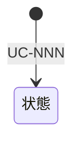

# 状態

## 状態モデル

| ID | コンテキスト | 状態モデル | 対象情報 |
| --- | --- | --- | --- |
| STM-01 | | | INF-NN（） |

## 状態の遷移

1行に1つの遷移を書く。初期は状態の列に「（初期）」、終端は遷移先状態の列に「—」と書く。状態は`STM-NN.状態名`で参照する。

| コンテキスト | 状態モデル | 状態 | 遷移UC | 遷移先状態 | 説明 |
| --- | --- | --- | --- | --- | --- |
| | STM-01 | （初期） | UC-NNN（） | STM-01.〈状態〉 | |

## 状態遷移図

### STM-01 〈状態モデル〉

