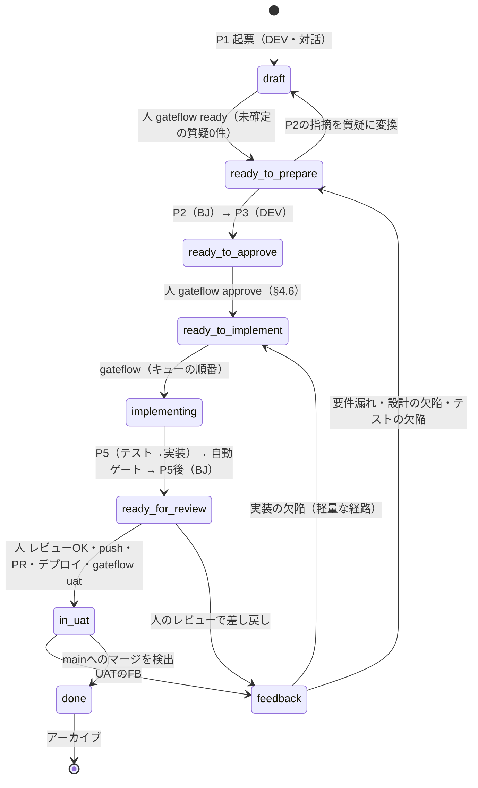

# gateflow 設計決定事項

最終更新：2026-10-11（M1の計画の回答を反映）。設計を変えるときは、設計の討議を経てこのファイルを更新する。

## 概要

gateflowは、AIDD（仕様カタログを正本とし、遷移表と人間関門で進める開発プロセス）をローカルで自動で回すオーケストレーターである。人間関門の数は減らさず、AI同士の遷移と、正本と成果物の整合の維持を機械に任せる。

HYDRA（POC_HYDRA_AUTH）で自作したフローの課題と、gateflowでの対策は次のとおり。

| 課題 | 原因 | gateflowでの対策 |
| --- | --- | --- |
| AIの作業中、人がブランチを切り替えられない | 作業ディレクトリを1つしか使っていない | タスクごとにcloneを作る |
| 権限確認で止まったことに気づかない | 対話モードで実行している | コンテナで安全性を担保して非対話で実行し、止まったら通知する |
| P5後の差し戻しで、正本と実装が乖離する | 遷移表にUATと差し戻しの経路がなく、チャットで巻き戻している | UATループと差し戻しを遷移表に組み込む |
| チケットがdoneにならず、retroが回らない | doneの記録を人に頼っている | mainへのマージを検出して、自動でdoneにする |

**開発の進め方。** HYDRAを要件から作り直す過程を、gateflowの実験台にする。元のHYDRA（V1。公開リポジトリ`POC_HYDRA_AUTH`）からは要件（カタログ）と規約を読み取り、新しいリポジトリ（HYDRA V2）でgateflowを実行して、ユースケース仕様・コード・テスト・チケットを作り直す。V1は読むだけで変更しない。取り込むときは業務の要件と実装の判断（DBのテーブル設計、カラムの扱いなど、V1の実装の中で決まったこと）を分け、実装の判断は取り込まない。どこまでを要件とみなすかは、M0の計画で一覧にして人が確認する。使って分かった問題をその場でツールに反映する。

## 社内方針と構造による担保

方針の趣旨は「AIが人の監視なしに外部や社内システムへアクセスしないこと」である。gateflowはこれをプロンプトのルールではなく、コンテナと権限の構造で守る。gateflow自体は、プロジェクトの隣に置きローカルで完結する条件で、外部ツールには当たらない。

| 制約 | 担保の方法 |
| --- | --- |
| ローカルの開発環境は制限なし | 自動実行してよい |
| 環境変数（秘密情報）を使う外部POSTは毎回承認 | エージェントに秘密情報を渡さない。外部POSTをOFFにした`.env`を読み取り専用で配置する |
| 外部へのGETは、負荷をかけず内部情報を送らなければ可 | 外向きの通信は許可リスト方式。エージェントは外への経路のない内部ネットワークに置き、許可リストのプロキシだけを出口にする。許可リストはLLMのAPIと認証に必要なホストに限る。パッケージの取得はエージェントの実行の外で、mainの定義からだけ行う（取得先のプロキシは要求されたパスに従って任意のサーバーへ取りに行くため、GETだけでも外へ送れてしまう）。依存の追加が必要になったエージェントは止まり、人が判断する |
| git pushは禁止（main・developは絶対禁止） | エージェントにgitの認証情報を渡さず、cloneにリモートを残さない。エージェントにはコミットさせず、cloneの`.git`を読み取り専用で渡す。コミットはgateflowが検証の後に、フックとfilterを無効にして人の名義で行う。pushとPRの作成は人が行う |
| 使えるAIサービスはClaude CodeとCursor | CLIの非対話実行を使う（Cursor CLIの非対話実行は許可される前提） |

「外部POSTできない」は、許可リストにないホストへはメソッドにかかわらず通信できない、という意味で守る。HTTPSの通信はプロキシからメソッドが見えないため、許可したホスト（LLMのAPIと認証）へのPOSTは止められない。そこへ送られるのは、もともとエージェントの実行でLLMへ渡す内容に限られる。

プロジェクトのフォルダの外に関わるものは、その都度確認して許可を得る。現時点で許可済みのものは次の5つ。

1. ツール本体（プロジェクトと同じ階層。読み取りのみ。実行ファイルのビルド時だけ書き込む）
2. 個人の設定（ホームディレクトリ。使うAIサービスと通知の設定）
3. AIサービスのログイン情報（Dockerのボリューム。gitの認証情報は入れない）
4. タスクごとのclone（Dockerのボリューム）
5. デスクトップ通知（gateflow本体がホストから出す）

## ワークフローと状態管理

状態機械の範囲をUATループとmainへのマージまで広げ、差し戻しも正式な遷移として扱う。遷移表の正本はJSONの定義で、人が読む`workflow.md`の表は定義から自動生成する。



AI同士の遷移（P2→P3、P5→P5後など）はgateflowが自動で進め、人は関門でだけ判断する。AI（エージェント）は状態を一切書かない。書くのはgateflowと人だけで、gateflowは遷移表に定義された遷移だけを実行する。差し戻しも遷移表に定義する。

| 状態 | 意味 | 次の状態 | 書く人 |
| --- | --- | --- | --- |
| `draft` | 質疑の回答待ち | `ready-to-prepare` | 人（`gateflow ready`。未確定の質疑が0件であることを確認） |
| `ready-to-prepare` | gateflowがP2（BJ）→P3（DEV）を実行 | `ready-to-approve`／指摘があれば質疑に変換して`draft` | gateflow |
| `ready-to-approve` | 実装の許可待ち | `ready-to-implement` | 人（`gateflow approve`。§4.6の承認＝キューへの登録。着手宣言は廃止） |
| `ready-to-implement` | 実装待ち（保留の印を付けられる） | `implementing` | gateflow |
| `implementing` | P5（テスト→実装）→自動ゲート→P5後（BJ） | `ready-for-review` | gateflow |
| `ready-for-review` | 人のコードレビュー。OKなら人がpush・PR作成・develop/stgへのデプロイ | `in-uat`／`feedback`／`done` | 人（`gateflow uat`。`done`は、人が git で main へマージした後の`gateflow done`） |
| `in-uat` | UAT中 | `feedback`／mainへのマージで`done` | 人／gateflow |
| `feedback` | FBの取り込み、質問と正本の差分の作成（対話） | 分類に応じた戻り先 | gateflow（人の確定後） |
| `done` | 完了。人が git で main へマージした後、`gateflow done`が作業ブランチの先頭が main に含まれている（祖先である）ことを確かめて書く。gateflow は main に書き込まない。マージの自動の検出（M4）で gateflow が書く経路を足す。アーカイブする | ― | 人（`gateflow done`）／gateflow（M4） |
| `cancelled` | 中止 | ― | 人 |

ドキュメントチケットはUATを通らず、`ready-for-review`のあとmainへのマージで`done`になる。

| 項目 | 決定 |
| --- | --- |
| 状態の管理 | 2層に分ける。ライフサイクルは指示書の`ステータス:`、実行中の状態（現在のstep・ループの回数・再開位置・ログ）はチケットごとの`runs/` |
| done | mainへのマージで完了。M2.5 からは、人が`gateflow done`で書く（作業ブランチの先頭が main に含まれていなければ、理由を示して失敗する。遷移表は`ready-for-review`→`done`（人）。2026-10-12、人の決定）。M4 で、コミットメッセージのT-NNNを検出してgateflowが書く経路を足す。squashマージでもT-NNNを残す。workflow.mdの「doneは人が書く」は改訂する |
| アーカイブ | `done`・`cancelled`のチケットは`.docs/_stash/archive/tickets/`へ移す。取り込み済みの要件依頼書も同様。gateflowは削除しない |
| retro | 人（PLなど）が`gateflow retro`で呼び出したときだけ実行する。自動では起動しない |
| 差し戻し | UATはmainへのマージ前なので、同じチケット・同じブランチで扱う |
| 差し戻しの対話 | diff・BJの指摘・レポート・FBを読み込んだ状態で始める |
| 差し戻しの出力 | 指示書・設計書の差分として確定させる。要件・設計の変更なのに正本の差分がなければ進めない |
| UATのFB | 原文をチケットに置く入力として扱う。AIは解釈せず質問と分類の案だけを作り、未確定の質問が残れば進まない（質疑にも同じ関門を適用）。反映後は閉じ、下流のstepには渡さない |
| 煮詰める工程 | 対話モードで人と行う。自動で回すのは、正本の差分が承認された後の下流だけ |

**FBの分類と戻り先**（社内のテスト基準の不具合要因を、gateflowの判断に必要な分だけに絞ったもの）

| 分類 | 戻り先 |
| --- | --- |
| 要件漏れ | 正本を直して`ready-to-prepare`（§4.6を取り直す） |
| 設計の欠陥 | 正本を直して`ready-to-prepare`（§4.6を取り直す） |
| 実装の欠陥 | `ready-to-implement`（軽量な経路。承認は取り直さない） |
| テストの欠陥 | P3のテスト設計からやり直す（`ready-to-prepare`） |
| 要望 | このチケットでは扱わず、新しい要件依頼書にする |
| その他 | 自動で戻さず、人の確認待ち（外部サービスの障害など） |

## エージェントの呼び出し

AIはCLIの非対話実行で呼び出し、Claude CodeとCursorのどちらを使う人でも同じフローが動くようにする。2つを併用して相互にレビューさせることは想定しない。

| 項目 | 決定 |
| --- | --- |
| 呼び出し方式 | CLIの非対話実行（Claude Code：`claude -p`、Cursor：`agent -p`）。SDKやAPIは使わない |
| 使うサービス | 環境ごとに1つ。個人の設定で指定し、既定値は設けない（許可のない人が意図せずClaude Codeを使うことを防ぐ） |
| アダプタの実装順 | Claude Code用を先に作り、開発もClaude Codeで進める。Cursor用は最後に追加して動作を確認する |
| BJの独立性 | 別プロセス・新しいセッションで起動し、成果物だけを渡す。作業場所は読み取り専用でマウントする |
| プロンプトの構成 | Persona・Knowledge・Instruction・Output Contract・Policyの5要素に分ける。Personaはシステムプロンプト、Policyはユーザーメッセージの最後に置く |
| BJの用途 | 同じPersonaで、P2のレビュー・P5後の突合・FBからの質問生成の3つのInstructionを使い分ける。DEVにも同じ構成を適用する |
| 結果の受け取り | 各stepが決まった場所にJSONを出力し、gateflowが検証する |
| セッション | stepごと、修正のたびに新しいセッションで始める。指摘や失敗ログはファイルで渡す |
| 認証 | コンテナ内でログインし、Dockerのボリュームに保存する |
| 渡すファイル | チケットはgit管理外でcloneに含まれないため、gateflowがstepごとに選んで渡す。UATのFBは下流のstepには渡さない |

**BJ。** HYDRAの`bj.md`の中身を引き継ぎ、5要素に分けて配置し直す。性格・原則（忖度しない、根拠のある指摘だけ、修正しない、意図を推測しない、自己申告を信用しない）はPersonaに、モード1（P2の要求レビュー）は`p2-review`、モード2（P5後の仕様突合）は`p5-verify`に移す。FBからの質問生成（`fb-questions`）を新設する。モード3（サイクル末の軽量検査）は廃止し、機械で確認できる部分を自動ゲートの検証コマンドに移す。

**DEV。** 新しく定義する。§4の範囲だけを作り、分からないことは推測せず質問として出力し、テストを先に書く。用途は`p1-plan`・`p3-prepare`・`p5-test`・`p5-implement`。`p5-implement`では`done`のほかに`test_defect`（テストの誤り）と`blocked`（範囲外の変更が必要）を報告でき、どちらも人の確認待ちになる。P5で更新してよい文書は、P3で§4に挙げたシートだけ。

**レビューのラベル。** BJの指摘と人のコードレビューの差し戻しは、深刻度ではなく次のラベルで表す。

| ラベル | 扱い |
| --- | --- |
| MUST | 遷移を止める。P2なら`draft`へ、P5後ならDEVの修正へ |
| Q | 遷移を止める。P2なら質疑に変換して`draft`へ、P5後なら人の確認待ち |
| IMO | 止めない。P2ならP3に渡し、P3が§4.1で1件ずつ対応（計画に入れた／理由を付けて見送った）を書く。P5後なら人のコードレビューで提示する |
| NR | 止めない。人のコードレビューで将来の対応の候補として一覧にする |
| NITS・FYI | 止めない。記録のみ |

P2でMUST・Qにしてよいのは、要求（何を満たすか）が欠けている・曖昧、範囲が決まっていない、外から見える契約が決まっていない、正本と矛盾している場合に限る。「どう作るか」の穴（ファイルの書き方、使う部品、実装の手順）はIMOにする。ただし、安全などの要求そのものが欠けているなら（例：「秘密がイメージに入らないこと」が要求にない）MUSTにする。理由：P2が実装の細部まで差し戻し、往復が増えた（T-002は12回、T-003は4回で27件。2026-10-13、人の決定）

**規約の目次。** 規約はプロジェクトにあれば使い、なければAIの判断に任せる。どのファイルを誰に渡すかを`project.json`の`policies`に目次として書く。置き場所や階層は自由で、Git管理外のファイルも読み取り専用で渡す。目次にないファイルは渡さない。ファイルがない、またはGit管理外の規約を使った場合は、実行の記録に残す。一部の規約はgit非管理の内部資料として運用する（現在は利用者が1人なので、人による結果の違いは問題にしない。本業のプロジェクトに導入するときは、そのプロジェクトの規約に置き換える）。

## 遷移判定と機械検証

機械検証は必要条件、AIの判定は追加の条件とする。AIの自己申告だけで完了とせず、どの遷移ルールにも当てはまらなければ人の確認待ちにする。

| 遷移 | 機械検証（必須） | AIの判定 |
| --- | --- | --- |
| P1 → draft | 指示書の§1§2が埋まっている。質疑の各項目にIDが対応している | 不要 |
| draft → ready-to-prepare（人） | 未確定の質疑が0件。指示書の種別が「実装」か「基盤」 | 不要 |
| P2（BJのレビュー） | 出力がスキーマに合う。指摘が参照するIDがカタログに実在する | 承認／要修正 |
| P3 → ready-to-approve | §3§4が埋まっている。種別が実装なら、受入条件が1件以上で、すべてユースケースのIDに対応する。種別が基盤なら、受入条件は0件で、§4.5のホストでの確かめ（コードレビューで読むものと、ホストでの手順と合格の基準）がある。P2のIMOに1件ずつ対応が書かれている。ID整合チェックに合格 | 不要 |
| ready-to-approve →（人） | §4.6のチェックがすべて入っている | 不要 |
| P5（実装） | ビルド・テスト・lintに合格。コミットメッセージにT-NNNがある | DEVの完了報告 |
| P5後（BJの突合） | ID整合チェックに合格 | 指示書・設計書とdiffの乖離の有無 |
| FBの分類 →（人） | 未確定の質問が0件。要件・設計の変更なら正本の差分がある | 分類の案と質問の生成 |
| done | mainにT-NNNを含むコミットがある。§4.5にホストでの確かめがあれば、§5に結果が書かれている。mainのID整合チェックに必須の指摘がない（M2.9） | 不要 |

検証に失敗した場合：出力がスキーマに合わなければ1回だけ再実行し、それでも失敗すれば人の確認待ちにする。機械検証に不合格なら、失敗の内容を付けて同じstepに差し戻す。

**プロジェクトの初回セットアップ。** GoやPHPなどプロジェクトごとに異なる部分は、初回のセットアップで設定に切り出す。AIがリポジトリを読んで案を作り、人が確認し、gateflowがmainで全検証コマンドの成功を確認してから運用を始める。設定に含めるのは、検証コマンドの対応表（build・test・lint）、エージェント用のコンテナイメージ、通信の許可リスト、外部POSTをOFFにした`.env`のひな形、サービスの扱いである。

**DBなどのサービス。** 共有・タスクごと・不要の3方式をプロジェクトの設定で選ぶ。MVPは共有と順次実行の組み合わせとする。

**IDの発番。** IDはAIが発番する。並行の実行（M2.9）では、2本のチケットが同じIDを発番しうるので、mainとの重複を2か所で検出する：P5後のBJの承認の後、作業ブランチへ取り込む前に、その時点のmainと作業ブランチを合わせた木（`git merge-tree`。ホストの作業ツリーとrefは変えない）でID整合チェックを行い、必須の指摘があれば取り込まずに止める。`done`のときにも、マージ後のmainでID整合チェックを行い、必須の指摘があれば`done`にしない。gateflowが発番する方式は後で検討する。

**ID整合チェック。** gateflowのスクリプトで行う（新規作成）。プレフィックスごとに正本のファイルと定義の見つけ方（表の1列目か、ファイル内の出現か）を`project.json`の`ids`に持たせ、設定にないプレフィックスはIDとして扱わない（`SHA-256`などの誤検出を防ぐ）。`ids`には、参照を探す範囲（`scan`）、廃止の印（`deprecatedMarker`。定義の行のセルがこの文字列で始まれば廃止）、子のID（`children`：区切り・定義のファイル・親と名前の列。「（初期）」のような括弧書きと「—」は定義とみなさない）も持たせる。依存関係の図は手で描かず、実際の参照関係から生成する。子のID（`STM-01.状態名`、`UC-003-AC-02`）も定義として実在を確かめる。M0では、カタログだけで確かめられる検査（未定義の参照・重複定義・廃止されたIDの参照・名前の不一致・参照されていない定義、子のIDは状態だけ）を作り、残りはM3で作る。

| 検査 | レベル |
| --- | --- |
| 未定義の参照 | 必須 |
| 重複定義 | 必須 |
| mainとの重複（並行作業での発番の衝突） | 必須 |
| 廃止されたIDの参照 | 必須 |
| 受入条件のIDを持つテストがない | 必須 |
| `ID（名前）`の名前が正本と違う | 推奨 |
| 参照されていない定義 | 推奨 |
| 確かめ方のない非機能要求 | 推奨 |

**必須と推奨。** 検証は2段階。必須は不合格なら遷移しない（フォーマット、lint、型チェック、テスト、ビルド、ID整合、コミットのT-NNN）。推奨は止めずに記録し、人のコードレビューで提示する（diffの大きさ、§4にないファイルの変更など）。レベルは`project.json`で変えられる。実行の順序は、速くて安い層から：P5（DEV）→自動ゲート→BJ→人のコードレビュー。

**規約の階層。** 組み込み → 組織共通 → プロジェクトの順に継承する。組織共通の層はMVPでは作らず、2つ目のプロジェクトに導入するときに追加する。プロジェクトの規約は既存の`.docs/operations/policies/`に置く。初回はAIが既存のコードから案を作り、運用中はretroが繰り返し出るBJの指摘を規約への追加として提案し、人が採否を決める。

**テストの定義。** HYDRAにはなかったので新設する。

| 層 | 実施 | 内容 | 出どころ |
| --- | --- | --- | --- |
| 単体テスト | 自動（P5） | 関数ごとの動作。入力の検査（必須・桁数・形式・境界値など） | 観点表のうち関数で検証できるもの |
| シナリオテスト | 自動（P5） | 受入条件ごとの正常系を、外から使われる関数（ハンドラ・ユースケース）の呼び出しの連結で確認する。DBは共有のサービスを使い、外部サービスはモックにする | 受入条件 |
| UAT | 手動（業務チーム） | 受入条件の確認と、画面でしか確認できない観点 | 受入条件、観点表の画面の観点 |
| ホストでの確かめ | 手動（人の代わりにホストで作業するAI。gateflowの外。`ready-for-review`の後） | gateflowの中で確かめられない動作（コンテナの起動など）。ホストで動かす前に、コードレビューでホストに影響する設定（ホストのフォルダを繋ぐ設定、特権での実行、外へ公開するポート）を確かめる。結果は指示書の§5に書く | §4.5 |

- 受入条件はユースケース仕様に節を設けて`UC-003-AC-02`の形で発番し、テストの名前かコメントにIDを入れる
- 指示書の種別は「実装」と「基盤」の2つ（ドキュメントの種別は、UATを入れるM4で足す）。実装のチケットは受入条件とテストケースを1件以上持ち、ホストでの確かめを書いてもよい。基盤のチケットは受入条件を持たず、テストケースは0件でよく、§4.5にホストでの確かめを必ず書く。対象IDに何を挙げたか（UCを含む）は種別を変えない（何を参照するかと、どう確かめるかを切り離す。2026-10-13）
- 設定ファイルに特定の文字が書いてあるかを確かめるだけのテストは作らない（書いた内容をもう一度読むだけで、動くかを確かめないため）。意味のあるテストが書けるとき（Goのコードを変えたときなど）は書く
- P5は`p5-test`（テストを先に書き、新しいテストが失敗することを確認）と`p5-implement`（`p5-test`で書いたテストのファイルの変更を禁止）に分ける。テストの誤りは`test_defect`で報告し、人の確認待ちにする
- E2Eテストは作らない。カバレッジは記録だけで、条件にしない
- テストの規約（`testing.md`）はプロジェクトの層に置き、初回はAIが既存のテストから案を作る

**観点表。** 社内の観点表を元に、P3でAIがチケットの触れる項目ごとに該当する観点を選び、テストケースを作る。観点の雛形の値（最大文字数など）が埋められなければ質疑にする（要件の穴の機械的な発見）。観点表はCSVで持ち、IDと「確認の方法」（関数か画面か）の列を追加し、更新者などの列は除く。機密の確認が取れるまで、中身は各プロジェクトの`.gateflow/`に置き、ツールには列の定義だけを置く。

**UATシート。** `gateflow uat`の実行時に、受入条件と画面の観点から生成する。既定はBacklogに貼れるMarkdown（見出しと箇条書き）。検証環境が複数のプロジェクトだけ、環境ごとの結果の列を持つCSVも出す。結果は`未実施`・`OK`・`NG`・`保留`・`対象外`の5つ。取り込み時に、未実施が残っていないか、存在しないIDがないか、NG・保留にコメントがあるかを検査する。

**AIの出力。** 各stepは`/out/result.json`に結果を書く。共通の項目は`outcome`（stepごとの選択肢）、`summary`、`questions`（空でなければ質疑に登録。BJの出力にはない）、`notes`。BJの指摘は`label`・`finding`・`evidence`（必須。ファイル・行・IDのいずれか）・`suggestion`・`options`（Qの指摘の選択肢）を持ち、人に確かめたいことはすべてQの指摘として書く（指摘と質問の二重をなくす。M2.9）。gateflowが根拠の実在と、ラベルと`outcome`の整合を検査する。根拠のIDは、カタログに定義があるか、指示書の対象IDに挙げた予定のID（`project.json`のIDの形式に合うもの）に限る。予定のIDは記録とレビュー報告に「予定」と残し、P5後に実在を確かめ、なければP5へ差し戻す。出力の形はGoの構造体で定義し、標準機能だけで検証する。AIに渡す出力形式の説明は構造体から生成する。

| step | 担当 | `outcome`の選択肢 | 固有の項目 |
| --- | --- | --- | --- |
| `p2-review` | BJ | `approved`／`needs_fix` | `findings` |
| `p3-prepare` | DEV | `done`／`needs_answer` | `current`（§3の現状）、`plan`（§4.1の方針）、`acceptance`、`testCases`、`sheets`（更新対象のシート）、`imo`（P2のIMOの1件ずつへの対応：計画に入れたか、理由を付けて見送ったか。§4.1の末尾に表で書く）、`hostCheck`（§4.5のホストでの確かめ：ホストで動かす前にコードレビューで読むものと、ホストでの手順と合格の基準。種別が基盤なら必須）、`unfilled`（埋められなかった観点の値）。指示書への書き込みはgateflowが行う（2026-10-12、M2のQ-03） |
| `p5-test` | DEV | `done`／`test_defect`／`blocked` | `tests`（テストと受入条件のIDの対応。§4.3が0件なら空でよい）、`verify`（実行した検証のコマンドと終了コード。`done`なら全部0で必須。正はgateflow自身の検証。M2.9） |
| `p5-implement` | DEV | `done`／`test_defect`／`blocked` | `changedSheets`、`blockReason` |
| `p5-verify` | BJ | `approved`／`needs_fix`／`needs_human` | `findings` |
| `fb-questions` | BJ | `done` | `items`（FBの1件ごとの分類の案と関係するID）、`questions` |

## 暴走防止と通知

上限はすべてプロジェクトの設定で調整できるようにし、下の値は初期値とする。調整の材料として、各stepの所要時間・往復回数・止まった理由を実行ログに記録する。

| 上限 | 初期値 | 超えた場合 |
| --- | --- | --- |
| チケット1回の実行全体のstep数 | 20 step | 人の確認待ち。再開位置を保存する |
| ループの往復（BJの指摘と修正、テストの失敗と修正） | 3往復 | 人の確認待ち |
| エージェントの無反応 | 10分 | 打ち切って記録し、人の確認待ち |
| エージェントの1回の実行時間 | 60分 | 打ち切って記録し、人の確認待ち |

上限に達する前でも、次の場合は進展なしとして止める：前回と同じ指摘（ID＋場所＋種類）が残っている、修正の前後でdiffが変わらない、同じテストが前回と同じく失敗している。

**再開（`resume`）。** 止まった実行（人の確認待ち・上限・エラー）は、`gateflow resume`で保存した再開位置のstepから続ける。clone の用意の段で失敗した実行は、始めようとしたstepから再開する。cloneに作業ブランチへ取り込まれていないコミットがあれば、原則として止める。例外として、止まった実行でgateflowが最後にコミットしたと記録したものとcloneの先頭が完全に一致し、そのコミットから親をたどると作業ブランチの先頭に着き、途中にgateflowの記録にないコミットが挟まっていないときだけ続ける（例：P5後のBJが人の確認待ちで止めたとき、まだ取り込んでいないP5のコミット）。どちらかが成り立たなければ今までどおり止める。作業ブランチへの取り込みは、今までどおりP5後のBJの承認の後だけで、承認されていないコミットは作業ブランチに入れない（2026-10-13、M2.7）

**AIの呼び出しの順番待ち。** 複数の`run`は同時に動いてよい（M2.9）が、AIの呼び出し（認証ボリュームを使うコンテナ：DEV・BJ・ARBのstep、ARBの試験、doctorのサンドボックス、`gateflow login`）は、同じ認証ボリュームについて同時に1つに限る（トークンの更新の競合を避ける。認証の写しやAPIキーにはしない。人の決定）。コンテナを起動する前に、ホスト全体の場所（利用者の設定のディレクトリ）に認証ボリュームの名前ごとの印（`O_EXCL`、プロセスIDとその開始時刻、生きていなければ取り直す）を取り、コンテナが終わったら外す。取れなければ失敗にせず、2秒ごとに取り直す（上限なし、取り消しには従う）。待っている間は黙らない：`run`は`log.jsonl`に`agent-wait`と`agent-acquired`を残して監視のUIに「AIの順番待ち」と出し、`gateflow login`は画面に、どのチケットのAIが動いているかを出す。時間の上限（1回の実行時間・無反応）は印を取った後から数える

**プロキシの名前。** 許可リストのプロキシのコンテナの名前と、内部ネットワークでの別名は、チケットごとにする（`gateflow-<プロジェクト>-<チケット>-proxy`、`gateflow-proxy-<チケット>`。M2.9）。内部ネットワークはプロジェクトで共有する。同じチケットの2つの実行は印で止まるので、チケットごとの名前で実行ごとに分かれる。後片付け（起動の前の残りの削除、終わりの削除）は自分の名前だけに行い、ほかの実行のプロキシを消さない。ARBの試験とdoctorは、それぞれ別の名前を使う

**同じチケットの2つの実行。** `run`と`resume`は、始める前にチケットの実行の印（チケットのディレクトリの`run.lock`。`O_EXCL`で作り、プロセスIDとその開始時刻を書く）を取り、取れなければステータスを書く前に止める。印のプロセスが生きていなければ（前の実行が異常に終わった）、取り直す（2026-10-14、M2.8。並行の実行の調査で、人が誤って2回`run`できることが分かったため）

**記録の書き込みの失敗。** 黙って捨てない（2026-10-14、M2.8。原則「失敗を取り繕わない」の具体）。状態と人が読む記録、次のエージェントの入力（`state.json`、レビュー報告、質疑、指示書、`running.json`、`feedback.md`・`diff.patch`・`verify.log`）が書けなければ、その実行を止め、理由（`write-failed`）を付けて人の確認待ちにする。再開の位置は、書けなかったときに行っていたstepで、stepはやり直す。止まった記録（`state.json`）自体が書けないときは、gateflowの標準エラーにも出す。診断用の記録（`prompt.md`、エージェントの標準出力と標準エラー、コマンドごとの検証のログ、`allowlist.txt`、指紋、`proxy.log`）は、書けなくても続け、`log.jsonl`に`write-error`（ファイルとエラーの文）を残す。`log.jsonl`自体に書けなければ標準エラーに出す。ファイルの削除は、ファイルがないことだけを無視する。書き込みのファイルの`Close`の失敗も、書き込みの失敗として扱う。後片付け（コンテナ・プロキシ・印の削除）の失敗は、止めずに`cleanup-error`として残す

**通知。** MVPでは、gateflowがホストからデスクトップ通知を出す（macOS・WSL）。SlackのDMは方針の承認後に追加する。その場合の条件は、送信するのはgateflowだけ、トークンはエージェントに渡さない、送り先は本人のDMに固定、内容はチケット番号・状態・止まった理由の種類だけ、とする。通知の設定は個人単位とする。

## 名前・配置・リポジトリ構成

ツールの名前はgateflow、リポジトリ名はPOC_ORCHESTRATORとし、プロジェクトと同じ階層に置く。当面は非公開で、将来公開する。プロセスの名前はAIDDのままとし、「AIDDのプロセスをgateflowで回す」と言い分ける。名前は英小文字・数字・ハイフンにそろえ、並び順に意味があるものは番号や日時を先頭に付ける。

| 箇所 | 名前 |
| --- | --- |
| ツールのリポジトリ | `POC_ORCHESTRATOR/` |
| コマンド | `gateflow` |
| プロジェクト側の設定 | `.gateflow/project.json` |
| 個人の設定 | `~/.gateflow/config.json` |
| Dockerのボリューム | `gateflow-auth-claude`・`gateflow-auth-cursor`、`gateflow-work-<プロジェクト名>` |
| 環境変数の接頭辞 | `GATEFLOW_` |
| プロセスの文書 | `.docs/operations/aidd/`（変更なし。`.docs/`も隠しディレクトリのまま） |

**実行場所。** gateflow本体（オーケストレーター）はホストで直接動かし、AIのエージェントだけをコンテナで動かす。Dockerのソケットをコンテナに渡さずに済み、デスクトップ通知もgateflow本体から出せる。実行ファイルはGoのクロスコンパイルでmacOS用とLinux用（WSLを含む）を作り、配布用のビルドはDockerの中で行うので、gateflowを使う人のホストにGoは不要である。gateflowを開発する人は、テストをホストのGoで行ってよい（Goの版は`go.mod`の`go`と`toolchain`の行で固定する）。Goのmoduleのパスは`gateflow`（公開先が決まったら変える）。

**組み込みの枠と補足。** `builtins/`は、枠（Git管理）とgit非管理の内部資料の補足に分ける。補足はビルド時にあれば埋め込み、なくてもビルドは失敗しない。組み込みの指紋が環境によって変わることは、利用者が1人の間は問題にせず、公開する前に扱いを見直す。

```text
作業ディレクトリ/
├ POC_ORCHESTRATOR/          ツール（gateflow。下に詳細）
└ POC_HYDRA_AUTH_V2/         作り直すHYDRA（実験台）
  ├ .docs/                   カタログ（V1から取り込む）、チケット（Git管理外）
  └ .gateflow/               プロジェクトの設定

POC_ORCHESTRATOR/            ツール（gateflow）
│ ├ cmd/gateflow/            コマンドの入口
│ ├ internal/
│ │ ├ config/                project.jsonと個人の設定の読み込み、書式のバージョンの検査
│ │ ├ workflow/              定義（JSON）の読み込みと検証、workflow.mdの表の生成
│ │ ├ engine/                遷移の評価、状態の2層管理、上限と進展なしの検知（M1ではP5だけを実行する）
│ │ ├ ticket/                指示書のステータス、チケット・実行ディレクトリ、アーカイブ
│ │ ├ workspace/             cloneの作成、作業ブランチの取り込み
│ │ ├ container/             エージェントと検証用コンテナの起動、マウント、通信の制限
│ │ ├ agent/                 claude/（先に作る）、cursor/、mock/（テスト用のダミー）
│ │ ├ prompt/                5要素の組み立てと層の解決、規約の目次
│ │ ├ output/                AIの出力の構造体と検証
│ │ ├ gate/                  検証コマンドの実行と判定
│ │ ├ idcheck/               ID整合チェック、依存関係の生成
│ │ ├ uat/                   UATシートの生成とFBの取り込み
│ │ └ notify/                デスクトップ通知
│ ├ builtins/                組み込みの層（実行ファイルに埋め込む。内部資料の補足はGit管理外）
│ │ ├ workflows/             aidd-impl.json、aidd-doc.json
│ │ ├ prompts/               personas/、instructions/、policies/
│ │ ├ templates/             カタログベースの文書のひな形、要件依頼書のスキル
│ │ └ viewpoints/            観点表の列の定義（中身は置かない）
│ ├ docker/agent-base.Dockerfile
│ ├ docker/proxy.Dockerfile     許可リストのプロキシ（bin/のLinux用の実行ファイルをFROM scratchに入れる）
│ ├ scripts/                 build.sh（配布用のビルドをDockerで行う）
│ ├ docs/                    この設計文書、plans/（マイルストーンの計画と質問）、policies/（このリポジトリ自身の規約）
│ └ bin/                     ビルドした実行ファイル
```

**定義の形式。** ワークフローの定義と設定ファイルはJSONで書き、Goの標準機能だけで読み込む（ライブラリの利用自体は許可されているが、この機能のためだけには追加しない）。人が読む`workflow.md`の遷移表は、定義から自動生成する。

**バージョンの整合。** `project.json`に設定の書式のバージョンと、前提とするgateflowのバージョンを記録する。書式が合わなければ実行を拒否し、MVPでは自動変換は行わない。書式のバージョンは`0`から始め、項目を足すたびに上げる（M0では`ids`と`policies`だけを必須とする）。ツールのバージョンはgitのタグで管理する。

**CLAUDE.md。** 鉄則は`policies/`に移し、CLAUDE.mdとAGENTS.md（Cursor用）には`.docs/`への案内だけを残す。

**チケットの構成。** チケットはGit管理外（GitHubを使えるプロジェクトでもIssueとはAPIを使わずに紐付け、IDはT-NNNで統一。コミットに`#123`を入れ、PRの本文は`Refs #123`）。

```text
.docs/_stash/
├ tickets/T-012/
│ ├ ticket.md          指示書（ステータス:の行をgateflowが読み書き）
│ ├ questions.md       質疑（回答者の列を持つ）
│ ├ reviews/01-p2.md   BJのレビュー報告（AIの出力から生成）
│ ├ feedback/02-uat.md 差し戻しのFB（人が原文を置く）
│ └ runs/<日時>/        state.json・log.jsonl・steps/<番号>-<step>/
├ requests/<日付-名前>/  要件依頼書の下書きと質問
└ archive/             終わったチケットと取り込み済みの依頼書
```

**バージョンの警告。** ビルド時にバージョン・手元の変更の有無・組み込みの指紋を実行ファイルに刻み、`project.json`の前提のバージョンと比べて警告する。厳格モードでは実行を拒否する。結果は実行の記録に残す。

**プロジェクトごとの設定。** `.gateflow/project.json`に、ブランチ、コミットメッセージ、Issue、パス、ワークフロー、エージェント（Dockerfile・`.env`のひな形・通信の許可リスト）、サービス、検証、上限、規約の目次、ID、`touchMap`（コードのファイルと確認すべき文書の対応）、UATの検証環境、観点表を持つ。`.gateflow/`にはほかに`agent.Dockerfile`・`env.template`・観点表、任意で遷移表・手順・ひな形の上書きを置く。初回は`gateflow setup`でAIが案を作り、人が確認し、mainで全検証が成功することを確かめる。

## 文書の構成

1つの事実は1か所だけに書き、寿命で置き場所を決める（ずっと残る決定は正本、1回の変更の指示はチケット、機械が作れるものは生成）。実装の正本はコードで、基本設計書・詳細設計書は作らない。仕様カタログは標準の構成を組み込みとし、ファイル名は単数形にそろえる。図はMermaidで書く。プロジェクトで種類を追加でき、標準の種類は削らない。

| 要素 | ファイル | ID | 作り方 |
| --- | --- | --- | --- |
| 概要 | `overview.md` | ― | 手で書く |
| アクター | `actor.md` | `ACT` | 手で書く |
| ロール | `role.md` | `ROL` | 手で書く |
| 外部システム | `external-system.md` | `EXT` | 手で書く |
| 業務の流れ | `buc.md` | `BUC`。`UC`・`EVT`・`TMR`もここで発番する | 手で書く |
| イベント | `buc.md`で発番 | `EVT` | 手で書く |
| タイマー | `buc.md`で発番 | `TMR` | 手で書く |
| ユースケースの詳細 | `uc/UC-*.md`（`buc.md`に定義のあるIDだけ） | 受入条件`UC-*-AC-*` | P3で作る |
| 情報 | `information.md` | `INF` | 手で書く |
| 状態 | `state.md` | `STM` | 手で書く |
| 条件 | `condition.md` | `CND` | 手で書く |
| バリエーション | `variation.md` | `VAR` | 手で書く |
| 画面の一覧 | `screen_list.md` | `SCR` | 手で書く |
| 入力仕様 | `input/INP-*.md` | `INP` | P3で作る |
| DBの定義 | `erd/`（テーブルごとの定義書は`erd/columns/`） | ― | スキーマから生成し、差分を推奨の検証で確認（下記） |
| 機能要求 | `functional-requirement.md` | `FR` | BUC・UCから生成 |
| 非機能要求 | `non-functional-requirement.md` | `NFR` | 手で書く。確かめ方（テスト・検証コマンド・規約・手動）を必須の列にする |

**テーブル定義書。** `erd/columns/`に、テーブルごとの全カラム定義を置く（ファイル名はテーブル名そのまま）。正本はコードとDBで、チケットで該当テーブルを触ったとき（P3で§4に挙げ、touchMapが候補を出す）にスキーマから生成し、同じ作業ブランチに含める。論理名・情報（INF）への紐付け・備考は人とAIが書く欄で、再生成では消さない（推奨の検証は物理の列だけを突き合わせる）。AIが推定した論理名は人のコードレビューで確認する。俯瞰のER図は任意で、MVPでは生成しない。描く場合はMermaidの`erDiagram`。ひな形は組み込み（`builtins/templates/catalog/erd/`）に置く。

**波及の確認。** カタログ横断のトレーサビリティの文書は、内容の矛盾の確認だけを残す（IDの存在や名前の一致はID整合チェックへ移す）。人向けのチェックリストは1つに統合する。UCの新設か追記かは「独立したアクターのゴールがあるか」を最優先の基準にする。

## コマンドと入口

| 分類 | コマンド |
| --- | --- |
| 準備 | `config`（個人の設定）、`login`、`setup`（プロジェクトの初回設定）、`doctor`（環境と定義の点検） |
| チケットを進める | `new`（P1の対話）、`new --from`（要件依頼書の取り込み）、`run`（人間関門まで進めて終了）、`watch`（常駐）、`status`（`--all`でアーカイブも） |
| 人間関門 | `ready`、`approve`、`done`（作業ブランチが main に含まれていることを確かめて完了にする。マージは git で行う）、`uat`、`feedback --from review／uat`、`hold`・`unhold`、`cancel`。機械検証付きで状態を書き換える。手での書き換えは警告のみ |
| その他 | `monitor`（読み取り専用の監視 UI。`127.0.0.1`だけで待ち受ける。`watch`（常駐）とは別）、`resume`、`check`（検証の手動実行。ID整合チェックと、指示書のステータスが遷移表の状態の一覧にあるか。`check ids`でID整合チェックだけ）、`retro`、`render`（workflow.mdの表の生成）、`version` |
| 内部用 | `proxy`（許可リストのプロキシ。人は使わない） |

**要件依頼書（非エンジニア向け）。** 業務チームはgateflowを使わず、プロジェクトに置いたスキルをCursorのコマンド（`/request`）で呼び出す。AIはカタログを読み、回答の例と選択肢を付けた質問で業務の判断を聞き切り、技術の判断は「エンジニアの判断事項」に分ける。業務に影響する技術の話（データの保存期間など）は依頼者に聞く。回答はチャットか質問ファイルで行い、推測で埋めない。出力はBacklogに貼るMarkdown（見出しと箇条書き、先頭に形式の版）。項目は「1. 背景と目的」「2. 依頼内容」「3. 業務の規則と例外」「4. 受入条件（具体例）」「5. 業務に影響する条件」「6. 業務上の未確定事項」「7. エンジニアの判断事項」。エンジニアは`gateflow new --from`で取り込み、6が空でなければ拒否し、7は質疑に登録する。

## MVPの計画

MVPは「HYDRAを要件から作り直すのに最低限必要な機能」とし、層ごとではなく、早くチケット1件を端から端まで通してから肉付けする。

| # | 内容 | 完了の基準（HYDRA V2） |
| --- | --- | --- |
| M0 準備 | ツールの骨組み、V2の作成とV1からのカタログ（`uc/`を除く）と規約の取り込み、組み込みのひな形、設計文書の配置 | ID整合チェックを手で実行でき、取り込んだカタログに誤りがない |
| M1 最小の1本 | 人が書いた指示書からP5だけを実行（clone、コンテナ、Claude Code、出力の検証、検証コマンド、commit、取り込み）。安全のため、時間の上限（1回の実行と無反応）だけをM2から前倒しで入れる。検証コマンドに不合格なら差し戻さず止める | 最も単純なユースケースが実装される。push・外部POST・`.env`の書き換えができないことを確認 |
| M2 流れを通す | 遷移表、状態の2層管理、人間関門のコマンド、上限（時間以外）と進展なしの検知、差し戻しのループ、`status`、ダミーのAI | 1件がP2→P3→P5→P5後→`ready-for-review`まで、関門以外の介入なしで進む |
| M2.5 監視 UI（完了。2026-10-12） | 読み取り専用のローカルの監視 UI（`gateflow monitor`）。`127.0.0.1`だけで待ち受け、口は`GET /`（埋め込みの HTML 1枚）と`GET /api/status`（JSON）、M2.8 からは`GET /api/ticket?id=`（チケットの詳細：正本の一覧と作業履歴）と`GET /api/source?path=`（tickets の下とカタログのファイルの本文）だけで、GET 以外は 405。読むのはプロジェクトの tickets の下の記録とカタログ（`ids.scan`の下）だけで、`os.Root`で範囲の外へ出ない。実行中の run の印（`running.json`：プロセス ID とその開始時刻）と、step・試行の開始の記録、プロキシの判定の逐次の記録。`done`のチケットは出さない。あわせて`gateflow done`と、遷移表にない状態のチケットを`gateflow check`が報告する検査（cancel の特例は作らず、遷移表に移行の行を足すか人がステータスを直す） | 実行中のチケットの step・試行の回数・経過時間と上限・往復の回数・直近のイベント・プロキシの拒否・エージェントの直近のツール呼び出しと、人を待っているチケットの止まった理由と次の操作が、1画面で分かる |
| M2.6 裁定役（ARB）（試行して見送り。2026-10-13） | P2 の差し戻しを、人の前に別の AI の役（ARB）が正本を根拠に裁定する step（`p2-arbitrate`）、出力の検査、契約の ID の守り（`project.json`の`contracts`）、既存の差し戻しで試す`arb-trial`。見送りの理由：試験で人の判断を減らせたのは 5〜7% で、人の回答の読み広げを根拠の種類では止められなかった。実装と試験の正解表は新しいモデルの評価のために残し、遷移表の P2 の差し戻しは元の「質疑に登録して draft へ」に戻した | — |
| M2.7 基盤のチケット | 指示書の種別（実装・基盤）と`ready`での検査、基盤のチケットの受入条件0件、§4.5のホストでの確かめ（P3の出力の`hostCheck`）、承認の§4.6への移動、§5のホストでの確かめの結果と`done`での検査、§4.3が0件のときのP5のテスト0件 | 種別が基盤のT-003がP3を通り、§4.5にホストでの確かめが書かれる |
| M2.8 エラーの扱いと監視 UI の1段目 | 記録の書き込みの失敗の扱い（状態の記録は`write-failed`で止める、診断用は`write-error`を残して続ける）。同じチケットの2つの実行を止める印（`run.lock`）。監視 UI の作り直し：見出しの帯（あなたの番・実行中・待機・今日の完了の件数）、あなたの番のカード（止まった → 承認待ち → 質問 → そのほか）、流れ（チケットごとに9つの段の帯。済んだ段・AI が作業中・人の番・止まった・まだを色で分け、段の往復の回数と、今の段の担当・様子を出す。並びは AI が作業中 → あなたの番 → 待機）、チケットの詳細（正本：指示書と対象 ID ごとのカタログのファイルと行。作業履歴：段とその繰り返しごとの、いつ・担当・結果・かかった時間、レビュー報告と質疑への参照）、最近終わったもの。段・状態・担当・結果・止まった理由・コマンドの表示名は遷移表の`display`に持たせ、画面と Go のコードに直書きしない。エージェントのツール呼び出しは出さない。並行の枠・カタログの重なり・人の判断の時間は2段目 | 実データ（T-001〜T-003 の記録）で、流れの段と往復の回数、作業履歴、正本の行が正しく出る |
| M2.9 並行の仕上げと小改善（完了。2026-10-16） | AIの呼び出しの順番待ち（認証ボリュームごと、ホスト全体の印。`login`も対象で、待つときは画面に出す）。プロキシの名前とネットワークの別名をチケットごとにし、後片付けは自分の分だけ。mainとのIDの重複を、取り込みの前（合わせた木）と`done`で検査。BJの出力から`questions`をなくしQの指摘に`options`。P5の出力に`verify`。P3にホストのOS。監視のUIの本文を`io.ReadFull`で読む | 2つのチケットを同時に`run`して（ダミーのAI）、AIの呼び出しが重ならず、プロキシが互いに消されない |
| M3 検証を固める | ID整合チェック、受入条件のテスト、P5の2分割、必須と推奨、規約の目次、`touchMap`、DBなどのサービス（共有方式。composeのサービスを内部ネットワークへ） | テストを書き換えて通そうとした場合に止まることを、わざと起こして確認 |
| M4 差し戻しと完了 | UATシート、FBの取り込みと分類、戻り先への遷移、`done`の検出、アーカイブ | UATの差し戻しを1件、正本へ反映してから`done`まで通す |
| M5 入口 | `new`、要件依頼書のスキル、`new --from` | 要件依頼書から`draft`を始められる |
| M6 仕上げ | 通知、`watch`、`setup`、Cursorのアダプタ、バージョンの警告、`render`、機能要求の生成 | 本業のプロジェクトに`setup`で導入できる |

MVPの完了は、M0〜M4が終わり、HYDRA V2のチケット3件以上（うち1件はUATの差し戻しを含む）を`done`まで通せたとき。各マイルストーンで、人の介入の回数、差し戻しの回数と分類、stepごとの所要時間、上限に達した回数、AIの出力の不正の回数を記録し、調整の根拠にする。

MVPでは作らないもの：書き込みの操作をする UI（関門の操作はコマンドで行う）、並列レビュー、stepごとのプロバイダ自動選択、パッケージの共有、ワークフローを対話で作る機能、形式検証との連携、CIでの実行。

## 未決事項と次の議題

要件定義は完了した。残る事項は、実装と並行して進めるものと、HYDRA V2で使いながら決めるもの。

- [ ] Cursor CLIの非対話実行の許可の確認（現在は許可される前提）
- [ ] SlackのDMの方針上の承認（MVPはデスクトップ通知のみ）
- [ ] 観点表とテスト基準が機密かどうかの確認（確認までは公開しない扱い）
- [ ] squashマージでもコミットメッセージにT-NNNを残す運用ルールの周知
- [ ] 上限の初期値、検証のレベル、ID整合チェックのレベルの調整（運用の記録を見て）
- [ ] DEV・BJのプロンプトの調整（HYDRA V2の作り直しの中で）
- [ ] gateflowの外で作業する経路（人の対話的な利用）に、同じ検証をpre-commitフックやCIで適用するか（MVPの範囲外）
- [ ] GitHub Issueの読み取り連携（GETのみ）と、ステータスの自動更新（POST。方針の承認が必要）
- [x] `project.json`の「Issue」の項目の形：`issue`を任意の項目にする（`tracker`、`commitRef`、`prRef`の書式。外部のAPIは使わず、課題の番号は指示書の欄に人が書く。2026-10-12、M2のQ-18で決定）
- [ ] 組織共通の規約の層（2つ目のプロジェクトへの導入時に追加。観点表の移し先）
